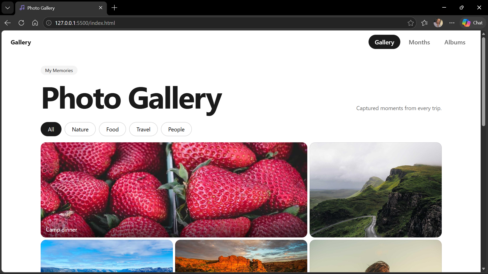

```# Photo Gallery

A responsive image gallery inspired by Google Photos, built with plain HTML, CSS and JavaScript (no frameworks).

**Live demo**[https://hope-022.github.io/image-gallery/]



````
## Features

- **Mosaic gallery** with a varied-size grid layout
- **Months view**: photos grouped by month; open a month to see them grouped by day
- **Albums**: create your own albums with the **+** card (saved in the browser)
- **Lightbox** with next/previous buttons, keyboard arrows, Esc to close and click-outside to close
- **Category filters** (Nature, Travel, Food, People)
- **Image filters** in the lightbox (B&W, Sepia, Warm, Cool, Vivid)
- **Hover effects and smooth transitions**
- **Favourites, share sheet, non-destructive photo editing, and a bin with undo**
- **Fully responsive** from phones to large desktops

## Tech

- **HTML5**: semantic structure (`header`, `nav`, `main`, `figure`, `article`)
- **CSS3**: Grid, Flexbox, custom properties, sticky positioning, media queries, keyframe animations, `filter`
- **JavaScript (ES6+)**: DOM manipulation, event delegation, `Map`/`Set`, `Intl.DateTimeFormat`, `localStorage`

## What I learned

- Grouping and sorting data by date, then rendering the UI from that data
- Building a responsive, mobile-first layout with CSS Grid
- Event delegation instead of attaching a listener to every element
- Escaping user input before inserting it into the DOM
- Reusing one render function for both months and albums

## Project structure

```
index.html
styles.css
app.js
README.md
```

## Run locally

1. Clone the repo: `git clone https://github.com/Hope-022/photo-gallery.git`
2. Open `index.html` in a browser (or use the VS Code Live Server extension)

## Future improvements

- Upload real photos and read their date from EXIF data
- Search by title
- Delete photos and edit albums